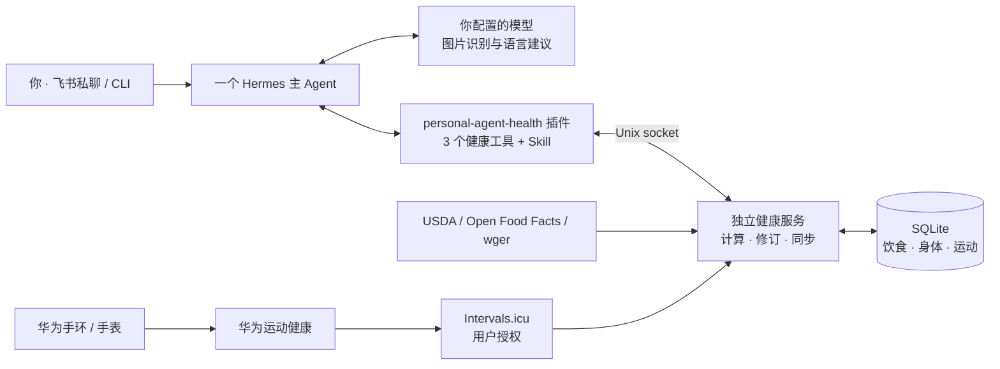

<div align="center">

# personal-agent-health

### 让你的 AI 助手，读懂你的华为穿戴健康数据。

**通过 Intervals.icu 接入华为手环／手表数据，与拍照饮食、体重和运动记录一起分析。**<br>
把吃了什么、运动多少、睡得怎样，放进同一本健康账本。<br>
程序负责同步和累计，Agent 结合记录解释趋势、提供建议。

**Alpha** · **华为穿戴接入** · **个人健康账本** · **MIT**

[华为穿戴接入](#华为手环和手表数据如何接入) · [快速开始](#快速开始) · [人工操作](#哪些步骤需要你操作) · [数据来源](#调用了哪些工具和数据源) · [隐私](#数据留在哪里) · [安装说明](docs/INSTALL.md)

</div>

## 它能帮你做什么？

华为手环和手表记录了运动、睡眠等健康信息，饮食和体重却常常需要另外记录。要让 AI 给出有依据的建议，需要把这些信息按日期整理起来，同时保留来源和缺失项。

personal-agent-health 将穿戴数据和日常记录汇入同一份结构化账本，供你的主 Agent 查询：

- **华为穿戴数据自动同步。**通过华为运动健康与 Intervals.icu 的授权链路，读取上游已同步的运动和健康摘要，减少手工补录。
- **拍照记餐。**识别食物后默认记录，给出份量和营养的估算范围；看不出的油、糖或份量会注明。
- **一句话纠正。**“米饭只吃了一半”“取消这餐”，修改原记录并保留历史；同一消息重试不会重复入账。
- **算清今天。**累计热量、蛋白质、脂肪、碳水，分别记录总糖与添加糖；缺失数据保留未知。
- **安排下一餐。**结合已记录饮食、个人目标和偏好，查询食物来源、核算份量后给建议。
- **把饮食、身体和运动放在一起看。**结合设备摘要、体重腰围与饮食记录按需复盘；有数据才分析，缺失时明确说明。

华为穿戴接入是本项目的重点使用场景，没有手环也能使用饮食和身体记录。项目按通用健康后端方向设计，继续复用一个主 Agent；当前代码提供 Hermes 适配，OpenClaw／MCP 接入和不依赖 Docker 的安装路线尚待实现与验收。

> 当前是面向自托管用户的 Alpha。照片估算不是称重测量，初始运动计划仍是基础模板。通用安装流程的验证范围见[兼容性说明](docs/COMPATIBILITY.md)。

## 快速开始

**1 · 把这一行发给有终端或 SSH 能力的 AI。**

```text
请帮我安装 personal-agent-health：读取 https://github.com/hkwc1002/personal-agent-health/blob/main/docs/INSTALL.md，按文档检查环境并完成安装和验收；复用现有 Hermes、模型和飞书，仅在登录、授权、隐藏输入密钥或必要权限确认时让我介入，不要把凭据发进聊天。
```

AI 会下载项目、检查兼容性、生成配置、启动健康服务、接入插件并报告验证结果。前提是它拥有目标机器的操作权限。普通聊天窗口无法代替你操作服务器。

> 当前仓库用于私人审阅，访问和安装需要 GitHub 仓库权限。AI 应使用已有授权获取文档，不要把访问令牌写进安装指令或链接。通用 Agent 接入与完整安装验收尚未完成，详见下方功能边界。

**2 · 完成必要的账号步骤。**

已有可用的 Hermes、模型和飞书私聊，可以直接复用。使用手环同步时，再连接 Intervals.icu 并在自己的终端输入密钥。[具体操作见下表](#哪些步骤需要你操作)。

**3 · 在飞书里开始使用。**

```text
帮我建立健康档案。
这张是今天的午餐。
刚才米饭只吃了一半。
今天蛋白质够了吗？晚餐怎么安排？
手环最近同步到了哪些运动和睡眠记录？
这周饮食、体重和运动怎么样？
```

首次建档可以分几次完成。发送食物照片即按估算记账，不必每餐点击确认；记录有问题，直接说明要改哪一项。

<details>
<summary><b>想自己安装？</b></summary>

克隆本仓库，进入目录后查看：

```bash
python3 scripts/install.py --help
python3 -B scripts/test.py
```

安装器默认只输出计划，加入 `--apply` 才创建安装目录并启动健康侧车。Hermes 插件激活由安装指南中的后续命令完成。需要 Python 3.11+、Linux 和可用的 Docker Compose v2。完整参数、宿主机/容器两种路线、验收和撤销步骤见 [INSTALL.md](docs/INSTALL.md)。

</details>

## 哪些步骤需要你操作？

| 项目 | 是否必需 | 你要做什么 | AI 可以做什么 |
| :-- | :-- | :-- | :-- |
| 服务器或本地 Linux | 必需 | 提供可用环境及必要操作权限 | 检查系统、Docker、目录与权限，安装项目 |
| Hermes 和模型 | 必需 | 若尚未配置，完成模型服务登录或密钥输入；照片功能需视觉能力 | 复用配置，检查插件接口和图片传递；不会替你注册付费服务 |
| 飞书机器人 | 使用飞书时必需 | 首次创建应用、批准权限、发布机器人；已有机器人可复用 | 接入现有配置，限制健康功能为本人私聊 |
| 个人健康档案 | 个性化目标需要 | 提供身体信息、目标、偏好和健康限制 | 分次收集、保存档案、计算初始目标 |
| 华为运动健康与 Intervals.icu | 使用华为穿戴同步时必需 | 确认设备数据已同步，在 Intervals.icu 授权华为连接，生成自己的 API Key | 配置同步，核对实际收到的运动、健康字段和最后成功时间 |
| 密钥输入 | 配置数据接口时需要 | 在自己的终端隐藏输入，不贴到 AI 聊天 | 提供本地输入命令，只检查文件权限与连接结果 |
| USDA API Key | 可选 | 离线库不够用时，申请自己的免费 FDC Key | 接入在线查询；默认离线食品库无需 Key |

安装可能需要系统提权或让 Hermes 重新加载插件。AI 会说明影响，并遵守你使用的工具和系统授权机制。插件扫描或登录验证码要求人工处理时，不跳过检查。

华为账号登录和授权由使用者在平台页面完成，本项目不收集华为账号密码。型号、账号地区和字段覆盖需按实际授权及返回数据确认，详见[华为接入说明](#华为手环和手表数据如何接入)。

## 整体结构



健康服务只使用 Python 标准库，独立运行在一个轻量容器里；没有公网端口，不需要 PostgreSQL、Redis 或额外 Agent。安装生成的配置为健康侧车设置 0.5 CPU、512 MiB 内存上限，这不是最低硬件需求或性能保证。

营养总量、单位换算、剩余额度和趋势由程序计算。模型识别照片、选择食物来源并解释结果；健康流水保存在 SQLite，不靠聊天记忆累计。

## 调用了哪些工具和数据源？

| 工具 / 数据源 | 用途 | 使用方式与边界 |
| :-- | :-- | :-- |
| [Hermes Agent](https://github.com/NousResearch/hermes-agent) | 对话、渠道、工具调用和 Skill | 使用官方插件入口；不修改 Hermes 核心 |
| Hermes 已配置的视觉模型 | 识别食物、读取营养标签、估算份量 | 模型或 `vision_analyze` 的费用与图片处理政策由使用者的提供方决定 |
| `health_record` | 食物入账、多图合并、精确文件去重 | 默认直接记录；重压缩或裁剪后的图片不保证识别为重复 |
| `health_query` | 营养查询、当天累计、下一餐依据、周报和趋势 | 读取结构化账本；`preview` 计算候选餐营养 |
| `health_manage` | 档案、目标、修订、体测、运动、备份与删除 | 修订检查版本；健康访问限制为本人私聊和本地 CLI |
| [USDA FoodData Central](https://fdc.nal.usda.gov/) | 基础食物营养 | 安装时下载官方 SR Legacy 2018-04 离线数据，按需查询在线 API；不是中国餐馆菜谱数据库 |
| [Open Food Facts](https://world.openfoodfacts.org/) | 有条码的包装食品营养 | 按条码查询详情，核对实际包装；自动扫码完整流程尚未实现 |
| [wger](https://wger.de/en/software/api) | 运动动作目录 | 按需查询动作信息，不是自动生成专业训练处方 |
| [Intervals.icu](https://intervals.icu/api-docs.html) | 承接华为等设备平台已同步的运动与日摘要 | 本项目读取的上游接口；首次回查30天，此后每小时回查最近7天，重复同步不重复入账 |
| Python / SQLite / Docker | 确定性计算、持久化与隔离 | 一份账本、一个侧车；模型和数据服务账号由使用者自行提供 |

本项目没有内置商业模型服务，没有遥测或统一账号，也不要求 Magpie。已有 Magpie 可以继续作为模型连接层。

代码许可和数据许可分别适用，详见 [THIRD_PARTY.md](THIRD_PARTY.md)。

## 华为手环和手表数据如何接入？

接入链路为：

```text
华为手环／手表 → 华为运动健康 → Intervals.icu → personal-agent-health → 你的 AI 助手
```

完成授权后，健康服务自动读取已经到达 Intervals.icu 的数据，不需要每天手工发送截图或导出文件。首次回查30天，此后每小时回查最近7天；同步中断后补查缺口，上游修订更新原记录。

| 数据 | 账本如何使用 |
| :-- | :-- |
| 运动类型、时长、距离、运动心率 | 保存设备运动，参与运动汇总，避免再次手工记录同一次训练 |
| 步数 | 查看日常活动量和近期变化 |
| 睡眠时长、可用睡眠评分 | 展示睡眠记录，作为建议时可参考的背景 |
| 静息心率 | 展示趋势，结合记录解释，不作医疗诊断 |
| 上游可用体重 | 与体重趋势一起查看，同一天本人手动记录优先 |

表中列出的是本项目能接收和保存的字段，不代表每个华为型号都会提供全部字段。可用体重等指标也可能来自其他设备或手动录入。本项目不保存 GPS 轨迹和秒级心率。

当天查询、周报、趋势与建议工具会返回设备摘要，供 Agent 结合饮食和身体状态解释。例如，可以查看一周的饮食记录、步行和体重变化，再讨论下一步怎样调整。每条建议是否充分使用这些信息，仍需通过实际 Agent 对话验收。

现有个人部署已跑通华为运动记录和健康摘要的接入；公开版不能据此承诺所有手环、手表、账号地区和健康指标均已验证。Intervals.icu 的日摘要可能合并多个来源，未提供单项来源时不能把全部指标归为华为测量。

健康服务每小时拉取的是上游已有数据。手机未上传、授权失效或平台尚未同步时，端到端延迟可能更长；查询会展示最后成功同步时间，缺失不是零。

运动热量不会自动增加当天可吃额度，单日设备数据不会自动改写目标。完整的睡眠/恢复评分驱动训练进阶尚未实现，不能宣传为已经验证的自动教练。

## 数据留在哪里？

- **账本留在你的机器。**数据库、备份和凭据与源码目录分离；升级代码不需要清空账本。
- **密钥只交给健康侧车。**Intervals.icu 和可选 USDA Key 存在本地受限文件，不进入 Skill、Git 或健康数据库。
- **图片沿用 Hermes 的处理链路。**健康服务不另存原图；如果你使用云端视觉模型，照片仍会发给该模型提供方。
- **健康工具拒绝群聊。**即使是本人在群里 @ 机器人，也不能通过这些工具查询个人健康账本。共享本地主机账号不构成多用户隔离。
- **可以导出、修订和删除。**清空健康账本会暂停设备同步；历史备份、飞书消息和模型提供方的记录需要分别处理。

仓库只包含代码、文档和合成测试数据，不包含作者的健康记录、账号标识、密钥、生产日志或数据库。请勿把运行目录上传为 Issue 附件。更多说明见 [SECURITY.md](SECURITY.md)。

## 目前的边界

单张照片看不出准确克重和隐藏油糖。中餐混合菜按食材和烹饪假设估算，保留区间与未知项；尚未完成独立称重的大规模准确率验证。

首版聚焦单用户 Linux 部署，支持现有 Hermes 在宿主机或 Docker Compose 中运行。Windows 原生健康服务、macOS 运行、多用户共享账本、自动上传训练课程和自动周期推送不在首版范围。Windows 用户可以让 AI 在已有 Linux VPS 上安装。

以上是当前实现范围，不是项目长期绑定的 Agent 或部署方式。通用接入完成前，安装说明仍按实际可执行的 Hermes 路线提供。

本项目提供记录、估算和生活方式建议，不用于医疗诊断。健康限制未明确前不自动生成减脂目标；有风险时保留记录功能，并避免高强度或极端限制建议。

## 开发与贡献

```bash
python3 -B scripts/test.py
python3 -B scripts/check_release.py
```

测试只使用临时目录和合成数据，不调用真实账号或模型。修复问题时请附上脱敏复现步骤，功能请求请说明场景。发布流程见 [RELEASING.md](docs/RELEASING.md)。

## 许可

[MIT](LICENSE)。第三方数据、上游软件和模型服务使用各自许可与条款。
