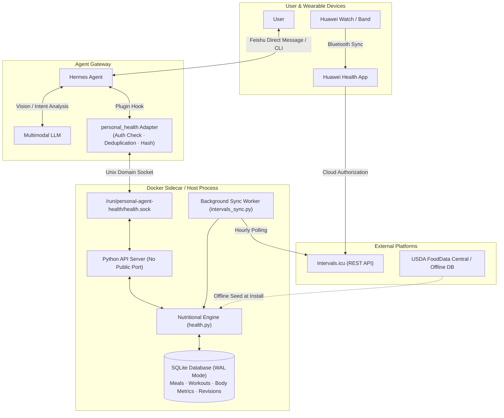

<div align="center">

# personal-agent-health

**An intelligent health management module deeply integrated into personal life assistants**

Connects Feishu (Lark) direct messaging, multimodal meal photo recognition, Huawei wearable physiological metrics, and a local deterministic nutritional ledger to provide personal AI agents with a grounded health data foundation and dynamic guidance capabilities.

**English** · [简体中文](README.zh-CN.md)

[](LICENSE)
[](https://www.python.org/downloads/)
[](https://docs.docker.com/compose/)

[Key Features](#key-features) · [Architecture & Data Flow](#architecture--data-flow) · [Quick Start](#quick-start) · [Data & Privacy](#data--privacy) · [Installation Guide](docs/INSTALL.md)

</div>

---

## Core Positioning

`personal-agent-health` is not a prompt template or a standalone LLM chatbot demo. It is a **self-hosted personal health service module** designed to run on personal infrastructure.

Integrated as a native plugin into an agent runtime (currently adapted for Hermes Agent), it bridges everyday lifestyle tracking into an operational workflow:
- **Grounding calculations & state**: Replaces LLM hallucination and context loss with deterministic nutritional calculations, historical aggregation, and SQLite persistence.
- **Breaking wearable data silos**: Ingests actual workouts and physiological load metrics tracked by Huawei smartwatches and fitness bands via Intervals.icu.
- **Frictionless daily logging**: Uses private messaging on Feishu (Lark). Sending a meal photo triggers multimodal parsing and structured logging, while natural language enables instant corrections without manual forms.

---

## Key Features

### 1. Everyday Feishu (Lark) Interaction & Natural Logging
- **Direct message logging**: Send food photos, text, or metrics (e.g., "Weight today: 68.5 kg") directly within a 1-on-1 Feishu chat. The agent dispatches requests to the underlying health engine.
- **Conversational amendments**: Make semantic adjustments retroactively (e.g., "I only ate half of that rice" or "Cancel that meal"). The engine verifies version numbers and tracks amendment history without creating duplicate entries.
- **Strict privacy boundaries**: Access is blocked in group chats at the gateway layer. Even if the bot is mentioned with `@` in a group, health tools refuse execution, ensuring records remain confidential to 1-on-1 chats.

### 2. Multimodal Dietary Analysis & Structured Extraction
- **Visual recognition**: Employs vision-capable LLMs to identify dishes, decompose mixed ingredients, and estimate portion sizes.
- **Detailed nutritional extraction**:
  - Macronutrients: Energy (`energy_kcal`), Protein (`protein_g`), Fat (`fat_g`), Carbohydrates (`carbs_g`).
  - Key dietary markers: Separates total sugars (`sugars_g`) from **free/added sugars (`added_sugars_g`)**, while tracking sodium (`sodium_mg`) and dietary fiber (`fiber_g`).
- **Interval estimates & explicit unknowns**: Stores restaurant meals and mixed dishes as three-point intervals `[low, best, high]`. Unseen cooking oils, added sugars, and seasonings are explicitly marked as unknown rather than guessed with false precision.
- **Idempotency & deduplication**: Verifies image SHA-256 hashes against trusted session message IDs to prevent duplicate bookings during message retries.

### 3. Key Data Integration: Huawei Wearables via Intervals.icu
- **Official authorization path**: Integrates through `Huawei Health -> Intervals.icu -> personal-agent-health` without requiring daily manual exports or screenshots.
- **Workout capture**: Syncs activity type, moving time, distance, average/max heart rate, and reported calories across running, cycling, swimming, and strength training.
- **Daily wellness metrics**: Pulls daily step counts, sleep duration, sleep scores, and resting heart rate (`resting_hr_bpm`).
- **Incremental sync worker**: Inspects the past 7 days hourly and retrieves 30 days during initial setup, recovering gaps after network interruptions.
- **Prudent energy accounting**: Device-reported calories are stored independently and never automatically added back to the daily food budget, preventing overeating caused by wearable energy overestimation.

### 4. Dynamic Personalized Guidance
- **Profile baseline**: Stores age, sex, height, weight, waist circumference, target metrics, dietary preferences, allergies, and physical limitations.
- **Next-meal planning**: Dispatches `next_meal` and `preview` actions to combine remaining macronutrient budgets, recent workout loads, and offline USDA food databases to recommend specific, actionable meals.
- **Trend review**: Analyzes 7-day weight averages, daily steps, sleep quality, and macronutrient adherence to generate objective weekly reviews.

---

## Architecture & Data Flow

The system operates with a lightweight host/sidecar isolation model. The health engine runs inside an isolated container with zero public open ports, communicating exclusively over a local Unix Domain Socket with the agent gateway.



### Tool Suite Overview

| Tool Name | Actions Supported | Description |
| :--- | :--- | :--- |
| `health_record` | `record` | Validates structured food items, portion ranges, and image hashes, saving meals to the ledger. |
| `health_query` | `today`, `preview`, `next_meal`, `trend`, `week`, `food_search`, `export` | Queries daily intake totals, simulates meal nutrition, retrieves wearable summaries, and exports weekly trends. |
| `health_manage` | `profile`, `targets`, `amend`, `weight`, `workout`, `complete`, `erase` | Manages user profiles, sets intake targets, performs atomic record revisions, and logs body metrics. |

---

## Quick Start

### 1. Prerequisites
- Operating System: Linux (x86_64 / arm64, Ubuntu 22.04+ or Debian 12+ recommended)
- Runtime: Python 3.11+, Docker Engine, and Docker Compose v2
- Existing Agent: A functional Hermes Agent installation configured with Feishu (Lark) messaging

### 2. Deploy Health Sidecar

Clone the repository and inspect the generated installation plan:

```bash
git clone __REPOSITORY_URL__.git
cd personal-agent-health

# Example: Generate an installation plan for host-mode Hermes
python3 scripts/install.py --mode host \
  --hermes-home /home/ubuntu/.hermes \
  --hermes-uid 1000 --hermes-gid 1000 \
  --destination /opt/personal-agent-health \
  --owner-id "ou_xxxxxxxxxxxxxxxx" \
  --timezone Asia/Shanghai
```
> Note: `--owner-id` specifies your Feishu User Open ID. Only this user is authorized to query or modify health data.

Apply the plan with elevated privileges:
```bash
sudo python3 scripts/install.py --mode host \
  --hermes-home /home/ubuntu/.hermes \
  --hermes-uid 1000 --hermes-gid 1000 \
  --destination /opt/personal-agent-health \
  --owner-id "ou_xxxxxxxxxxxxxxxx" \
  --timezone Asia/Shanghai \
  --apply
```
The installer builds the container image, seeds the offline USDA food database, creates a dedicated system user, and starts the Unix socket daemon.

### 3. Enable Hermes Plugin
Switch to the user account running Hermes, validate the plugin, and enable it:
```bash
hermes plugins validate /home/ubuntu/.hermes/plugins/personal-agent-health
hermes plugins enable personal-agent-health
```
Restart your Hermes gateway process to complete activation.

### 4. Connect Huawei Watch via Intervals.icu (Optional)

1. **Authorize Huawei Health**:
   - Log into [Intervals.icu](https://intervals.icu/).
   - Navigate to `Settings` -> `Connections`, find Huawei Health, and authorize access.
   - Verify that your Huawei workouts and daily summaries appear on the Intervals.icu calendar.
2. **Retrieve API Credentials**:
   - Locate your `Athlete ID` and generate an `API Key` under `Settings` -> `Developer Settings`.
3. **Configure Locally**:
   Run the interactive credential tool in your terminal to store the API key securely in a restricted file:
   ```bash
   sudo python3 scripts/configure.py intervals --destination /opt/personal-agent-health
   ```
4. **Restart Sidecar**:
   Restart the container to trigger the initial 30-day sync:
   ```bash
   docker compose -p personal-agent-health -f /opt/personal-agent-health/compose.generated.json restart health
   ```

---

## Example Interactions (Feishu Direct Message)

Once installed, interact directly with your agent in Feishu:

```text
# 1. Establish Profile
User: Help me set up my health profile. Height 178 cm, weight 73 kg, sedentary job, gym twice a week. Goal: cut to 68 kg.
Agent: [Calls health_manage profile/targets, calculates BMR, and sets daily macronutrient targets]

# 2. Meal Logging via Photo
User: [Sends a photo of lunch]
Agent: Lunch logged: ~650 kcal (580–740 kcal), 28g protein, 85g carbs, ~4g free sugar. Cooking oil estimated at standard restaurant levels. Let me know if you didn't finish everything!

# 3. Natural Language Corrections
User: I left 1/3 of the rice, and I had a can of zero-calorie cola.
Agent: [Calls health_manage amend for atomic update] Updated lunch entry: deducted ~18g carbs and added diet beverage. Current entry version: v2.

# 4. Actionable Next-Meal Guidance
User: How are my numbers from the watch today? What should I have for dinner?
Agent: [Calls health_query today to retrieve wearable stats and dietary totals]
Huawei watch synced: 5.2 km morning run (avg HR 142 bpm), 8,430 steps, sleep score 82.
Remaining intake budget: 580 kcal with a 35g protein deficit.
Dinner recommendation: 150g grilled chicken breast or steamed fish + 200g broccoli + half bowl of brown rice.
```

---

## Data & Privacy

- **Local storage**: Health metrics, meal records, and audit snapshots are stored locally in SQLite (`health.sqlite3`) using WAL mode.
- **Zero image retention**: The sidecar does not store copies of uploaded food photos. Images are analyzed in-flight by your configured multimodal LLM.
- **Strict least-privilege**: The service runs under an isolated UID, listens solely on a local Unix socket, and exposes zero network ports.
- **Full sovereignty**: Export your complete history as JSON at any time using `health_query export`, or purge all records permanently with `health_manage erase`.

---

## License

This project is licensed under the [MIT License](LICENSE). Third-party datasets (such as USDA FoodData Central) are governed by their respective licenses; see [THIRD_PARTY.md](THIRD_PARTY.md) for details.
